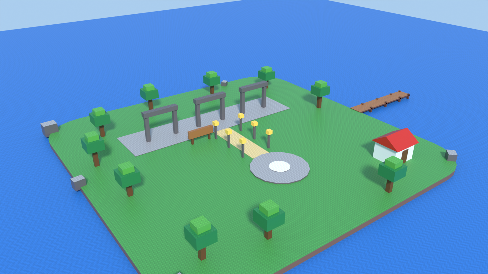

# A.R.T.Y
A AI for roblox game and more

## Pescaria do Abismo: Hub

Lobby com portais que levam os jogadores para o lugar do jogo de pesca.

### Como funciona
- Três portais no hub: **Solo** (1 jogador, servidor privado), **Grupo** (até 4, servidor privado) e **Público** (até 8, servidor público).
- Pisou no portal, entrou na fila. A contagem começa em 15s e cai para 3s quando o portal enche.
- O botão **Sair da fila** tira você do portal.
- No fim da contagem, todo mundo do portal é teleportado junto. Se der erro, o teleporte tenta mais 3 vezes.
- Uma tela de carregamento aparece durante o teleporte e continua enquanto o jogo carrega.

### Estrutura
```
default.project.json           -> projeto Rojo
src/shared/HubConfig.luau      -> configurações (PlaceId, portais, tempos)
src/server/HubServer.server.luau -> filas, portais, contagem
src/server/TeleportManager.luau  -> teleporte com repetição
src/client/HubClient.client.luau -> interface da fila e tela de carregamento
```

### Configuração
1. Crie uma experiência com **dois lugares**: o Hub (lugar inicial) e o Jogo.
2. Copie o PlaceId do lugar do **Jogo** e coloque em `GAME_PLACE_ID` no arquivo `src/shared/HubConfig.luau`.
3. Sincronize com o Rojo (`rojo serve`) no lugar do Hub e publique.
4. Para usar portais com visual próprio, crie uma pasta `Portais` no Workspace com Parts chamadas `Solo`, `Grupo` e `Publico`. Sem elas, os portais são gerados automaticamente.

> O teleporte **não funciona no Studio**. Teste num servidor publicado.

Sem Rojo: crie os scripts manualmente com os mesmos nomes. `HubConfig` vai como ModuleScript em `ReplicatedStorage/Shared`, `HubServer` (Script) e `TeleportManager` (ModuleScript) em `ServerScriptService/Server`, e `HubClient` (LocalScript) em `StarterPlayer/StarterPlayerScripts/Client`.

## Mapa do Hub (Blender)



O mapa é gerado pelo script `blender/build_hub_map.py`, que também cria a textura de stud (procedural e original) em várias cores. Tem ilha, água, praça de spawn, caminho de areia, praça com os 3 arcos dos portais, placa, postes de luz, píer de pesca, cabana, árvores e pedras.

Arquivos gerados:
- `blender/hub_map.fbx`: para importar no Roblox (texturas embutidas)
- `blender/hub_map.blend`: para editar no Blender
- `blender/textures/*.png`: as texturas separadas, caso precise subir manualmente

Para gerar de novo depois de editar o script:
```
blender -b -P blender/build_hub_map.py -- blender
```

### Importar no Roblox
1. No Studio, abra o lugar do **Hub** e vá em **Arquivo > Importar 3D**. Escolha `hub_map.fbx`.
2. Nas opções: unidade **Stud**, marque **Insert Using Scene Position** e **Anchored**, e desmarque **Merge Meshes**.
3. No modelo importado: na `Agua`, use `CanCollide = false` e `Transparency = 0.3`. Nas `Luz*`, use `Material = Neon`. Na `Ilha`, use `CollisionFidelity = Box`.
4. Coloque um **SpawnLocation** em `(0, 1, 20)`, em cima do círculo branco.
5. Os portais do script do servidor aparecem sozinhos dentro dos arcos, em `(-30/0/30, 0.7, -40)`.
